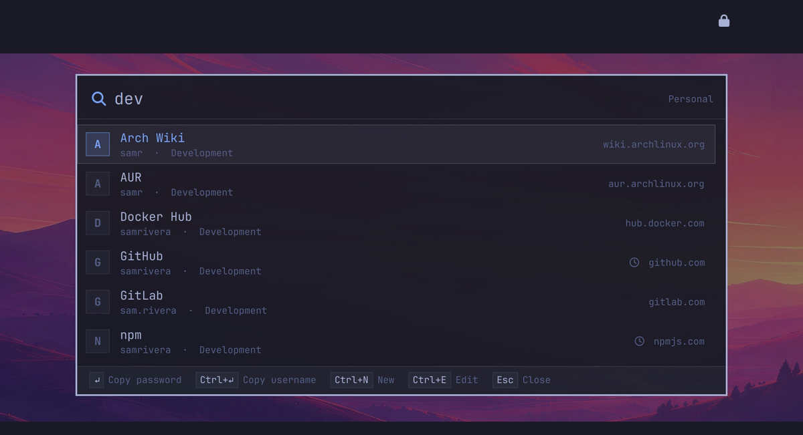

# Keylane for the Omarchy bar

A bar widget for [Keylane](https://github.com/alexpomsft/keylane), the
keyboard-first KeePass (KDBX) password manager for Wayland and Hyprland.



The widget shows a lock that tells you whether your vault is locked:

| Icon | Meaning |
|---|---|
| closed lock | vault locked, or no vault chosen yet |
| open lock (highlighted) | vault unlocked |
| highlighted, tooltip mentions conflicts | a sync conflict needs resolving |
| dimmed | Keylane is not running (click to start it) |

| Click | Action |
|---|---|
| Left | open the Keylane search launcher |
| Middle | open the Keylane manager |
| Right | lock the vault now |

## Requirements

[Keylane](https://github.com/alexpomsft/keylane) must be installed, with the
`keylane` command on the shell's `PATH` (for example `~/.local/bin/keylane`).
If it isn't installed, the widget hides itself.

The widget asks `keylane status` for the lock state every few seconds. That
command reports only state, never secrets.

## Install

```sh
omarchy plugin add https://github.com/alexpomsft/omarchy-keylane --enable
```

Enabling adds the widget to the right section of your bar. You can move it
from Omarchy's bar settings.

## Settings

| Setting | Default | Description |
|---|---|---|
| `refreshIntervalSec` | `3` | How often to poll `keylane status` (1–60 s) |
| `showWhenStopped` | `true` | Show a dimmed icon when Keylane isn't running instead of hiding it |

## Remove

```sh
omarchy plugin remove alexpomsft.keylane
```

This removes the widget from the bar and deletes the plugin folder. Keylane
itself and your vault are untouched.

## License

MIT, see [LICENSE](LICENSE).
